# FreshFold – Class Diagram

The diagram shows the real class names from `src/`. GitHub renders Mermaid diagrams automatically.

```mermaid
classDiagram
    direction LR

    class Customer {
        -int customerId
        -string fullName
        -string phone
        -string address
        +Customer(fullName, phone, address)
        +Customer(customerId, fullName, phone, address)
        +getCustomerId() int
        +getFullName() string
        +getPhone() string
        +getAddress() string
        +setCustomerId(id)
        +setFullName(name)
        +setPhone(phone)
        +setAddress(address)
    }

    class LaundryOrder {
        -int orderId
        -int customerId
        -string serviceType
        -double quantity
        -double unitPrice
        -string status
        -string paymentStatus
        -string orderDate
        +LaundryOrder(serviceType, quantity, unitPrice)
        +calculateBill() double
        +getServiceFee() double
        +getBillBreakdown() string
        +moveToStatus(newStatus)
        +cancel()
        +canEditDetails() bool
        +getNextStatus() string
        +setQuantity(quantity)
        +setStatus(status)
        +setPaymentStatus(status)
        #describeQuantityTimesPrice() string
    }

    class DryCleaningOrder {
        -double handlingFee
        +DryCleaningOrder(numberOfItems, pricePerItem, handlingFee)
        +getHandlingFee() double
        +calculateBill() double
        +getServiceFee() double
        +getBillBreakdown() string
    }

    class OrderFactory {
        <<functions>>
        +createOrder(serviceType, quantity) unique_ptr~LaundryOrder~
        +createOrderWithPrices(serviceType, quantity, unitPrice, serviceFee) unique_ptr~LaundryOrder~
        +currentUnitPrice(serviceType) double
    }

    class PriceList {
        <<constants>>
        +WASH_FOLD_PER_KG
        +STEAM_PRESS_PER_ITEM
        +DRY_CLEAN_PER_ITEM
        +DRY_CLEAN_HANDLING_FEE
    }

    class DatabaseConfig {
        +string server
        +int port
        +string database
        +string user
        +string password
        +parse(iniText) DatabaseConfig
        +loadFromFile(path) DatabaseConfig
    }

    class DatabaseManager {
        -DatabaseConfig config
        +addCustomer(Customer&) int
        +findCustomerById(id, Customer&) bool
        +getAllCustomers() DataTable
        +searchCustomers(text) DataTable
        +updateCustomer(Customer)
        +deleteCustomer(id)
        +addOrder(LaundryOrder&) int
        +findOrderById(id) unique_ptr~LaundryOrder~
        +getAllOrders() DataTable
        +searchOrders(text) DataTable
        +updateOrderDetails(LaundryOrder)
        +updateOrderStatus(id, oldStatus, newStatus)
        +cancelOrder(id)
        +getDashboardStats() DashboardStats
        +countUsers() int
        +getPasswordHash(username) String
        +createFirstUser(username, hash) bool
        +getTotalPaid(orderId) double
        +getPaymentsForOrder(orderId) DataTable
        +recordPayment(orderId, amount, method) string
    }

    class AuthenticationService {
        -DatabaseManager& database
        +isFirstRun() bool
        +login(username, password) bool
        +createInitialAdmin(username, password, confirm)
        +hashPassword(password)$ String
        +verifyPassword(password, storedHash)$ bool
    }

    class BillingService {
        -DatabaseManager& database
        +calculateBill(LaundryOrder&)$ double
        +quote(serviceType, quantity) BillQuote
        +loadInvoice(orderId, Invoice&) bool
        +formatInvoice(Invoice)$ string
        +recordPayment(orderId, amount, method) string
    }

    class Invoice {
        +Customer customer
        +unique_ptr~LaundryOrder~ order
        +double total
        +double totalPaid
        +double balance
    }

    class LoginForm
    class DashboardForm
    class CustomerForm
    class OrderForm
    class BillingForm

    note for LaundryOrder "calculateBill(), getServiceFee() and getBillBreakdown() are virtual"
    note for DryCleaningOrder "overrides calculateBill(), getServiceFee() and getBillBreakdown()"

    LaundryOrder <|-- DryCleaningOrder : inherits
    OrderFactory ..> LaundryOrder : creates
    OrderFactory ..> DryCleaningOrder : creates
    LaundryOrder ..> PriceList : formats money
    OrderFactory ..> PriceList : reads prices
    DatabaseManager *-- DatabaseConfig
    DatabaseManager ..> Customer : saves / loads
    DatabaseManager ..> LaundryOrder : saves / loads
    DatabaseManager ..> OrderFactory : rebuilds orders
    AuthenticationService --> DatabaseManager
    BillingService --> DatabaseManager
    BillingService ..> Invoice : builds
    Invoice o-- Customer
    Invoice o-- LaundryOrder
    LoginForm --> AuthenticationService
    DashboardForm --> DatabaseManager
    DashboardForm ..> CustomerForm : opens
    DashboardForm ..> OrderForm : opens
    DashboardForm ..> BillingForm : opens
    CustomerForm --> DatabaseManager
    OrderForm --> DatabaseManager
    OrderForm --> BillingService
    BillingForm --> BillingService
    BillingForm --> DatabaseManager
```

## Layers

| Layer | Classes | Rule |
|---|---|---|
| GUI (C++/CLI Windows Forms) | `LoginForm`, `DashboardForm`, `CustomerForm`, `OrderForm`, `BillingForm`, `Ui` | Reads input, shows results. No prices, no SQL. |
| Business logic (standard C++) | `Customer`, `LaundryOrder`, `DryCleaningOrder`, `OrderFactory`, `PriceList`, `BillingService`, `AuthenticationService` | Validation, pricing, status rules, password hashing. |
| Data access | `DatabaseManager`, `DatabaseConfig` | The only place with SQL. Parameterized statements only. |

`OrderFactory` is not a class – it is two free functions in `src/Models/OrderFactory.cpp`. It is shown in the diagram because it decides which class (`LaundryOrder` or `DryCleaningOrder`) is created.
